# 实践项目2：个人实验报告

## 1. 基本信息
- GitHub 登录名：15873669723
- 个人仓库地址：https://github.com/15873669723/my-docs
- 最终网站地址：https://15873669723.github.io/my-docs/

## 2. 实践过程与关键截图

### 2.1 仓库创建
在 GitHub 创建公开仓库 my-docs，默认分支 main，添加 README。
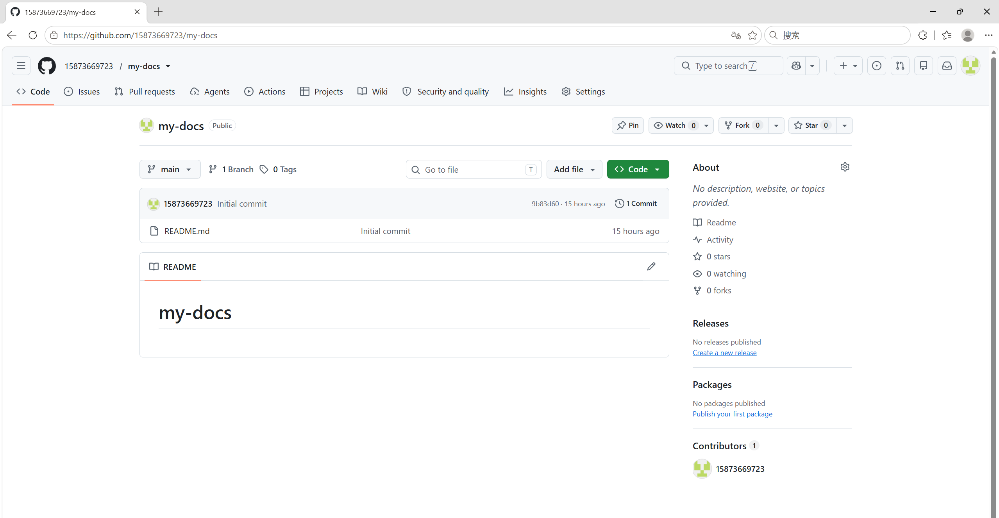

### 2.2 项目结构与 MkDocs 配置
docs/ 存放 Markdown 源码，site/ 是构建产物（已加入 .gitignore），nav 定义页面导航顺序。
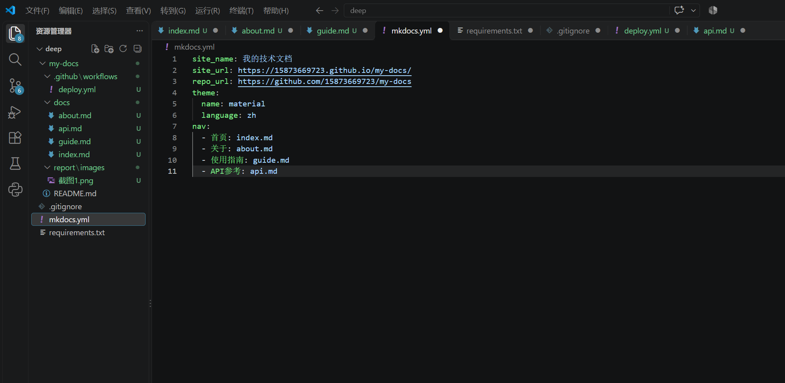

### 2.3 本地构建与预览
使用虚拟环境安装依赖，执行 mkdocs build --strict 构建成功。
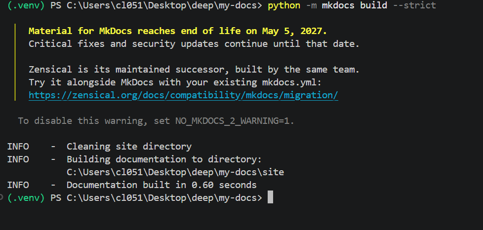

### 2.4 Pages 设置
在仓库 Settings → Pages 中将 Source 设为 GitHub Actions。
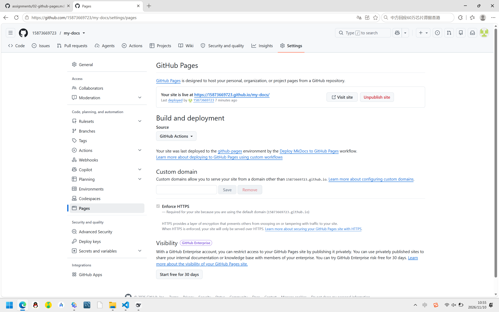

### 2.5 Actions 首次构建和部署
推送后工作流自动触发，build 和 deploy 均成功，耗时约1分39秒。
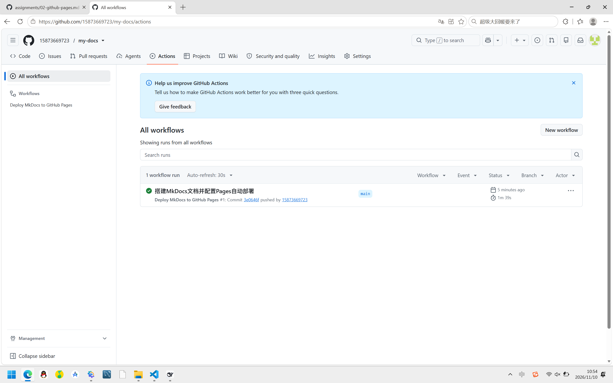

### 2.6 网站访问与四页导航检查
访问网站，首页、关于、使用指南、API参考四个页面均正常显示，导航链接可用。
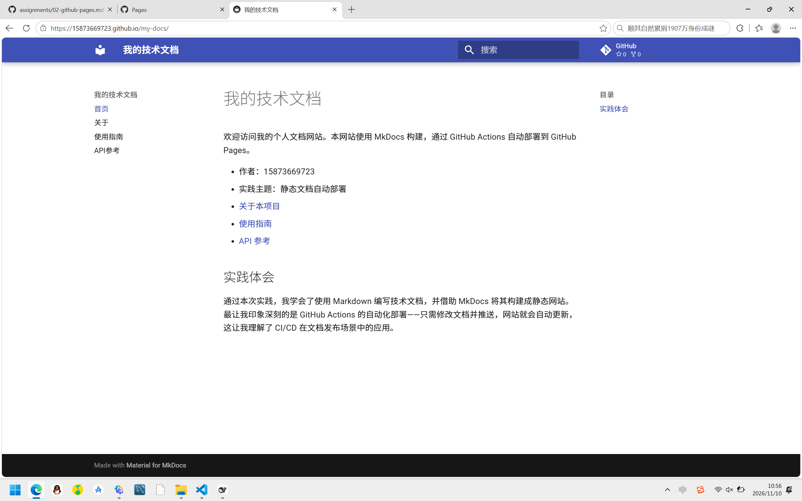
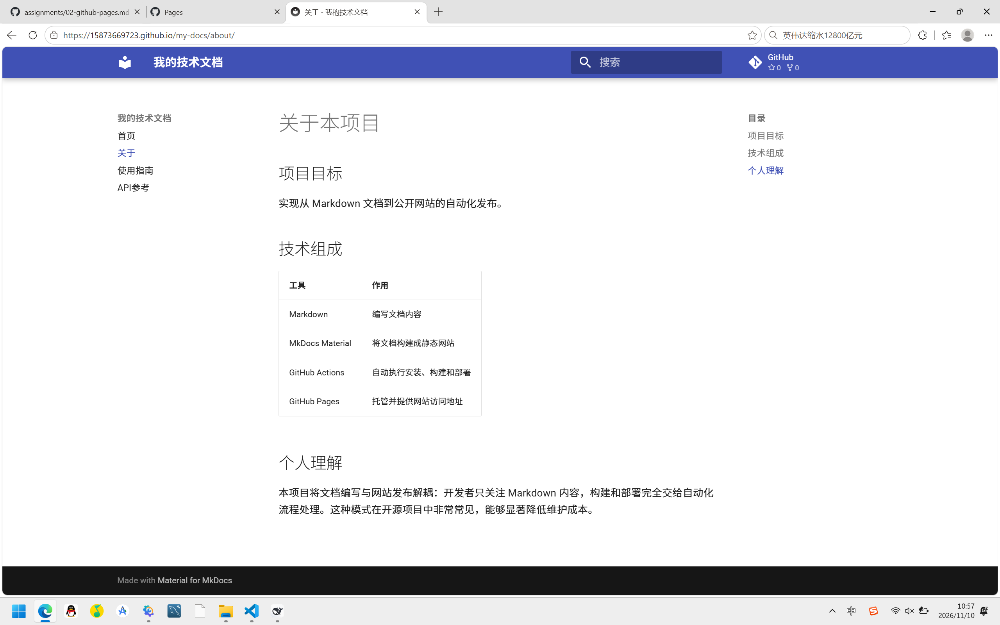
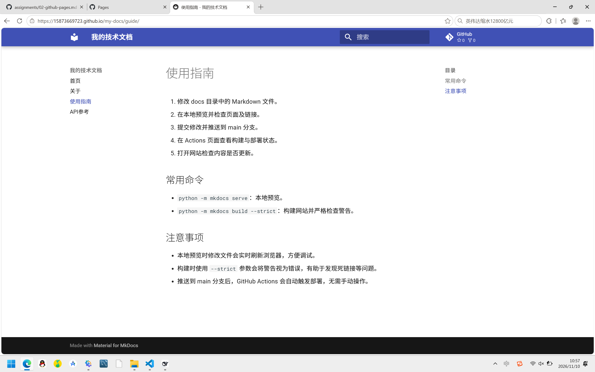
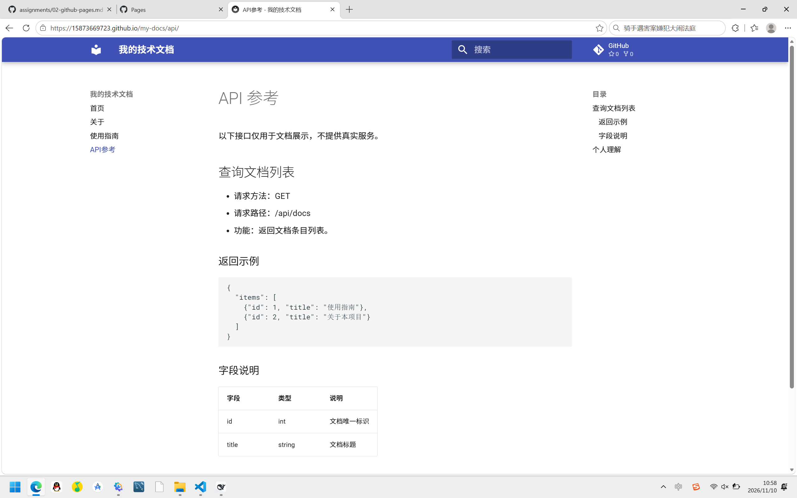

### 2.7 第二次推送与自动更新验证
在 index.md 添加验证文字后推送，Actions 自动触发并部署成功，网站刷新后显示新内容。
- 对应提交链接：https://github.com/15873669723/my-docs/commit/9b1035c
- 对应 Actions 运行链接：https://github.com/15873669723/my-docs/actions/runs/42746805478
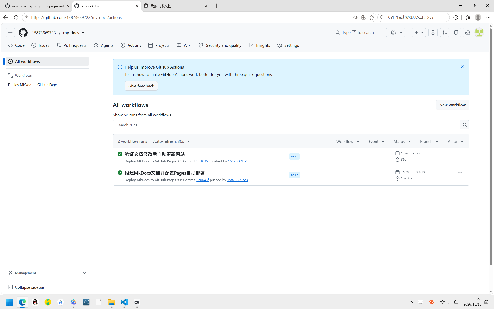
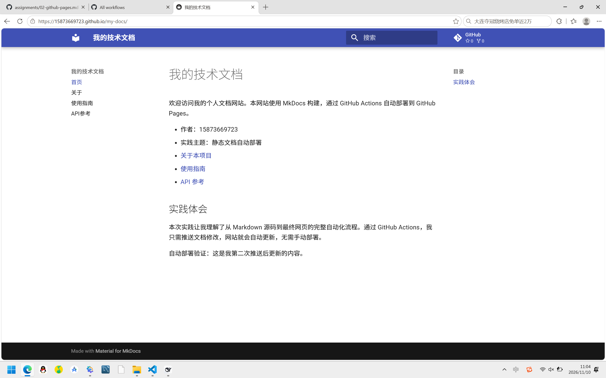

## 3. 问题与解决

1. **pip 下载缓慢/卡住**：使用清华镜像源 `-i https://pypi.tuna.tsinghua.edu.cn/simple` 解决。
2. **PowerShell 执行策略限制**：使用 `Set-ExecutionPolicy -Scope Process -ExecutionPolicy Bypass` 临时放行。
3. **mkdocs.yml 等文件位置错误**：文件被创建在 my-docs 外面，移动到正确位置后构建成功。

## 4. 原理理解

1. **docs/ 和 site/ 各保存什么？**
   docs/ 保存 Markdown 源码，是网站的内容来源；site/ 是 MkDocs 构建生成的静态网站文件（HTML/CSS/JS）。不手动修改 site/ 因为它每次构建都会重新生成，手动改会被覆盖。

2. **本次工作流在什么情况下自动运行？**
   当 docs/ 目录下的文件、mkdocs.yml、requirements.txt 或工作流文件本身被推送到 main 分支时自动运行。只修改 report/ 或 README 不会触发。

3. **build 与 deploy 两个任务有什么区别？**
   build 负责 checkout 源码、安装 Python 依赖、执行 mkdocs build 生成 site/ 并上传为 artifact；deploy 负责将 build 上传的 artifact 发布到 GitHub Pages。deploy 通过 needs: build 确保在 build 成功后才执行。

4. **只修改 report/README.md 会触发部署吗？**
   不会。因为工作流的 paths 过滤只包含 docs/**、mkdocs.yml、requirements.txt 和 deploy.yml 本身，report/ 不在触发范围内。

5. **本次方案为何无需创建 gh-pages 分支？**
   使用了 GitHub 官方的 Pages Actions 工作流（upload-pages-artifact + deploy-pages），构建产物通过 artifact 传递并直接部署到 Pages 环境，不需要像传统方式那样把静态文件推送到专门的 gh-pages 分支。